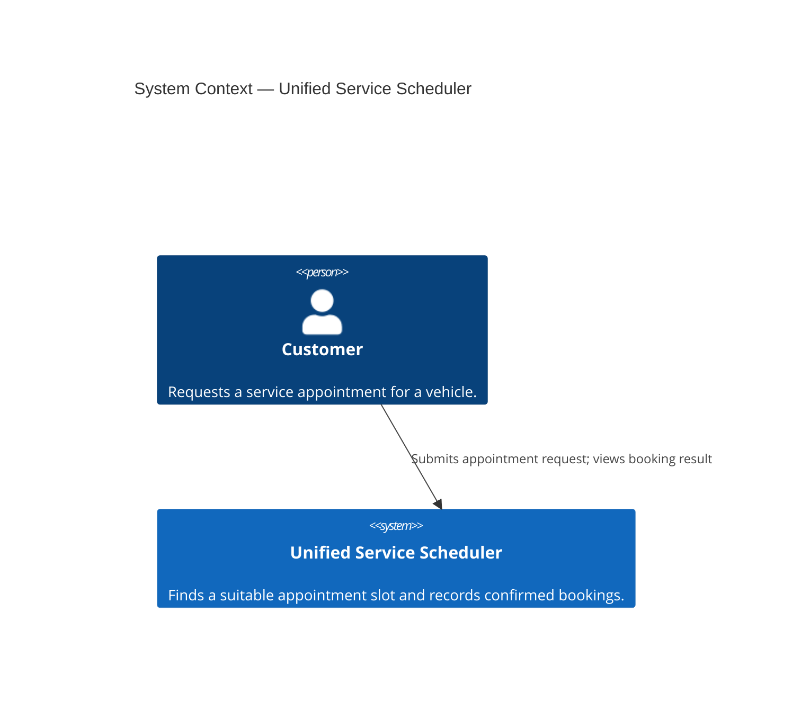
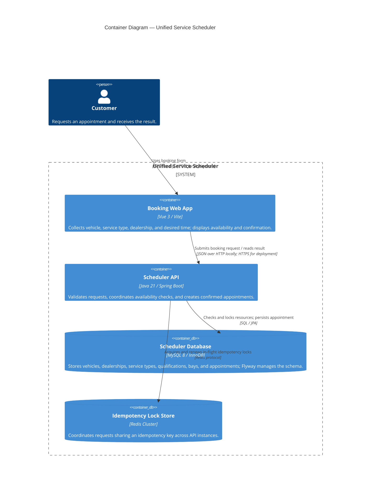
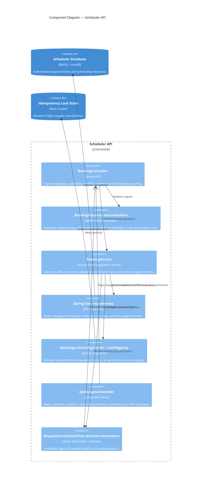
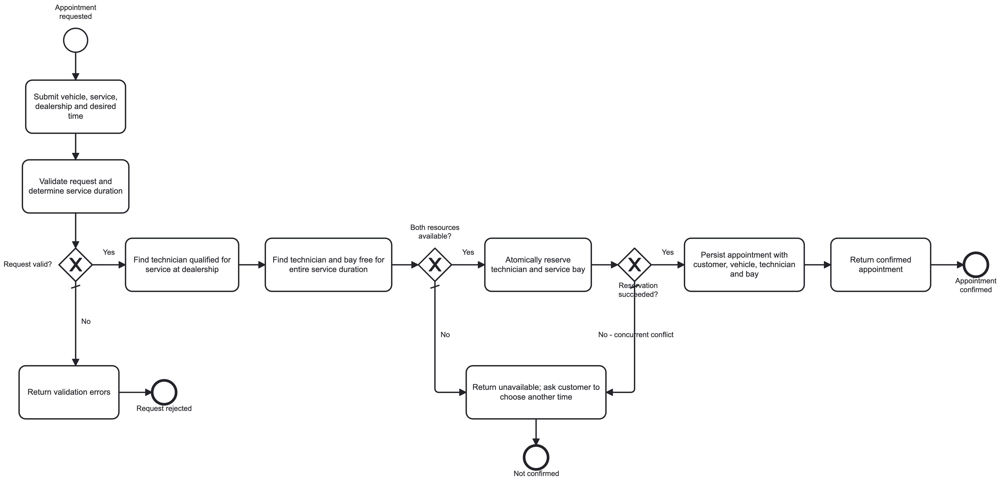

# Scenario A: Unified Service Scheduler — System Design Document

## Scope and chosen technologies

The selected service layer is the **backend**: a REST API with persistent MySQL storage and OpenAPI documentation. A Vue booking page is also supplied as a demonstration client. The central booking rule is that a qualified technician and a service bay must both be available for the entire service duration. The implementation additionally prevents overlapping confirmed appointments for the same vehicle across dealerships.

The challenge requires an appointment associating the customer, vehicle, technician, and bay. The current implementation persists the vehicle, dealership, service type, technician, bay, interval, and status, but **does not persist a customer identity or customer association**. The customer is currently only the actor using the demo UI; this is an implementation gap against that requirement, not a completed capability.

The [technology choices and justifications](scenario-a-technologies.md) accompany this document. The implemented stack uses Java 21, Spring Boot, Spring MVC, Jakarta Bean Validation, Spring Data JPA/Hibernate, MySQL/InnoDB, Flyway, springdoc OpenAPI, Vue 3/Vite, JUnit/Spring Boot Test, and Docker Compose. Integration tests use a separately configured MySQL test database rather than Testcontainers. Vue Router and Pinia are recommendations in the technology document, not dependencies of the single-page demo.

Redis Cluster and Spring Integration's `RedisLockRegistry` coordinate in-flight idempotency keys across backend instances. Redis provides a shared lock rather than appointment storage; MySQL remains the authoritative store. Micrometer/Actuator, Prometheus exposition, and Logback with a Logstash JSON encoder provide the observability described below. See the [application README](code/README.md) for build/run/test prerequisites and operational details.

## Level 1 — System Context

## Level 2 — Container Diagram

## Level 3 — Scheduler API Components

The diagram maps to implemented classes and framework responsibilities. Qualification checks, availability checks, and scheduling orchestration are methods within `BookingService`, not separate deployed services or independent checker classes.

## Booking flow and key rules

The BPMN diagram above expresses the business flow; Redis coordination and database locking below describe its current implementation.

1. The UI loads bounded catalog options and submits dealership, vehicle, service type, and desired start time. `GET /api/availability` is advisory: it checks the whole interval but does not reserve resources.
2. `POST /api/appointments` validates the payload. For an optional `Idempotency-Key`, the API acquires a shared Redis lock and checks for a previously committed result. An identical retry returns the original appointment; reuse with a different payload returns `409`. A concurrent request using the same key receives `202` and can poll `GET /api/appointments/idempotency-result`.
3. Inside a `READ COMMITTED` transaction, the service loads the dealership without a dealership-wide lock and locks the vehicle row using `NOWAIT`. It resolves service duration and rejects a confirmed vehicle overlap, including one at another dealership. A vehicle lock conflict returns `409` promptly.
4. The service searches qualified technicians and bays at the chosen dealership using `SKIP LOCKED`, then rechecks overlaps while holding candidate row locks. Both resources must cover the full interval. Adjacent appointments are allowed; a partial overlap is not. Requests can skip locked candidates and try another pair.
5. If no usable pair is found, booking returns `409`; this can reflect contention as well as existing reservations. Otherwise the service persists the appointment and its allocated resources atomically. The transaction releases database locks on completion; the idempotency lock is retained through commit or rollback. A unique database constraint on the key protects persisted idempotency results.
6. The UI displays the result or polls an in-flight keyed request. Polling returns `202` while processing, `200` for a stored result, or `404` when no result is recorded; after rollback, the client can retry the POST with the same key.

## Scalability, performance, reliability, and maintainability

- **Scalability:** API instances share MySQL and Redis. Locking individual vehicles, technicians, and bays avoids serializing every booking at a dealership. Disabling Redis selects an in-process idempotency registry suitable for one backend instance only.
- **Performance:** Catalogs are paginated and bounded. Resource selection queries are bounded, and status-aware indexes support interval overlap checks. Availability does not guarantee a subsequent booking because another transaction can reserve resources first.
- **Reliability:** MySQL row locks and transactional rechecks protect allocation. Redis locks have a two-minute lease renewed every 40 seconds; a process pause or outage can lose a lease, so database locks and uniqueness remain final safeguards. Default pool acquisition and InnoDB lock waits are three seconds; Redis connection/command timeouts are two seconds. The default booking transaction deadline is 25 seconds and is enforced at database operations rather than as an HTTP request timer. Mapped database timeout failures return `503` with `Retry-After: 1`.
- **Maintainability and verification:** Controllers, transaction orchestration, repositories, entities, and exception mapping have distinct responsibilities. Flyway versions schema changes and Hibernate validates mappings. Automated tests exercise validation, qualification, full-duration overlaps, persistence/rollback, concurrent allocation, idempotency, and metrics against the relevant database behavior. Performance tests are opt-in; coverage measurement remains follow-up work. This document update did not rerun tests or establish new performance results.

## Observability strategy

### Logging and request correlation

`RequestCorrelationFilter` reuses a safe incoming `X-Request-Id` or generates one, returns it in the response, and places it in the logging context. It also extracts a trace ID from an incoming `traceparent` matching the implemented format. Logback emits readable console logs for local/test profiles and JSON to stdout for other profiles, including service and environment fields. Booking events record attempts, success, rejection, or failure, with dealership ID and booking ID where available. Customer details, VINs, and raw idempotency keys should not be added to log fields.

A booking-completed event is emitted before the surrounding transaction commits, so it is diagnostic evidence rather than a durable audit record. For deployment, a log collector can forward JSON stdout to a central logging system; no collector or hosted logging backend is bundled.

### Metrics and health

Actuator exposes `/actuator/health`, `/actuator/info`, `/actuator/metrics`, and `/actuator/prometheus`. The service records `booking.requests` and `booking.duration` by outcome, `booking.availability`, `booking.lock.wait` by resource/outcome, `booking.resource.search`, and `booking.resource.overlap.checks` by resource. Availability, lock, and resource-search timers publish histogram buckets. Metrics appear after the corresponding operations run.

Use these signals to investigate conflict/error rates, booking and search latency, and resource contention. Lock timers measure the application acquisition operation, not database-engine blocked time; overlap summaries count attempted queries, not rows scanned. Metric tags use bounded categories, keeping identifiers in logs rather than metric labels.

Prometheus scraping, dashboards, alert rules, and access controls for management endpoints are deployment work, not included services. A deployment should monitor sustained failures and latency against agreed targets and combine health with dependency diagnostics; no SLO thresholds or alert delivery are currently configured.

### Tracing

Current support correlates logs with an incoming trace ID. It does not create/export distributed spans or instrument end-to-end database and Redis traces. A future deployment can add OpenTelemetry or Micrometer Tracing instrumentation and a collector to follow requests across dependencies. This is planned capability, not an implemented tracing pipeline.

## GenAI collaboration during system design

I used GenAI as a design partner while retaining ownership of scenario selection, stack choices, booking rules, and acceptance decisions. I first established the booking flow and architecture before requesting implementation scaffolding. AI helped draft the C4 model, BPMN flow, technology options, and test scenarios. I chose a Spring REST backend with OpenAPI, MySQL for familiarity and transactional persistence, and Vue for an interactive demonstration client.

I reviewed the proposed design against the requirement that a qualified technician and a bay must both be available for the entire service duration. I challenged assumptions and added the same-vehicle overlap rule across dealerships. I compared generated implementation with the chosen architecture, directed a move from JDBC to JPA/Hibernate, and required MySQL tests when H2 limitations affected concurrency checks rather than changing production behavior to satisfy the substitute database.

Design refinement continued through reviews of scalability, performance, reliability, maintainability, and observability. This led to resource-level locking instead of a dealership-wide lock, bounded queries, overlap indexes, idempotent retries, explicit timeouts, and booking instrumentation. The design now distinguishes shared Redis request coordination from MySQL allocation correctness and separates implemented correlation from future distributed tracing. AI suggestions were reviewed against requirements, code, and test evidence before acceptance; generated documentation also required correction when it overstated customer association or retained an outdated locking strategy.

The [AI Collaboration Narrative](code/README.md#ai-collaboration-narrative) describes implementation guidance and verification in more detail. The [project walkthrough](WALKTHROUGH.md) records the design decisions, challenges, and lessons across the development process.

## Assumptions captured in the model

- The booking user is modeled as the customer; the challenge does not specify separate staff-facing workflows.
- The scheduler owns its booking and resource data. No external dealer-management system or notification provider is required by the stated scenario.
- Appointment creation must be atomic with allocation checks. The implementation locks vehicle and selected resource rows within a transaction; it does not lock the dealership row.
- The demo accepts local date/time values without a complete dealership timezone policy. A production design must define timezone and daylight-saving behavior.
- Customer identity, its persistent appointment association, and ownership verification remain unimplemented; the customer actor in the diagrams does not imply those features exist.
- Authentication, payment, cancellation, rescheduling, and notification behavior are outside the stated acceptance criteria and are not modeled.
