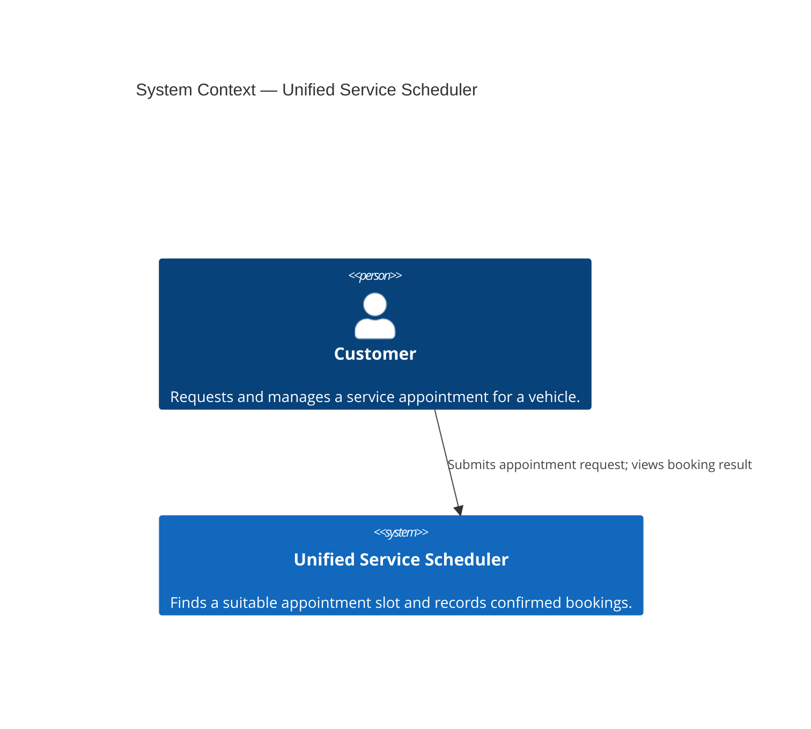
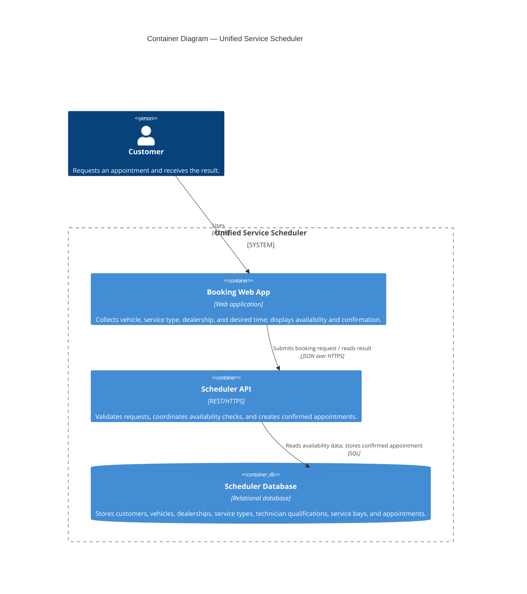
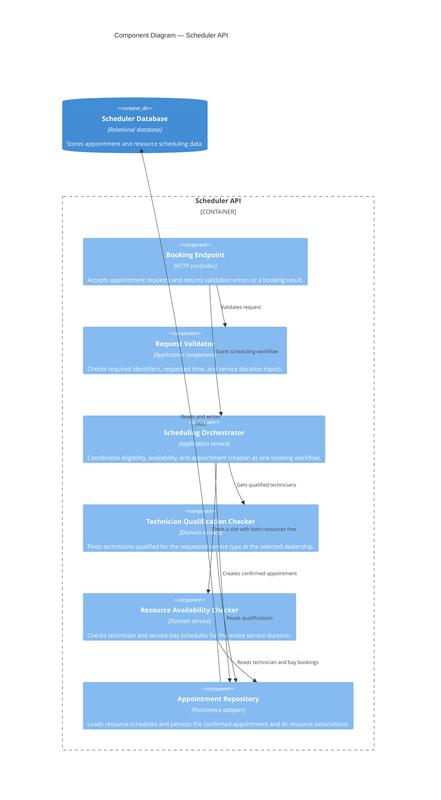
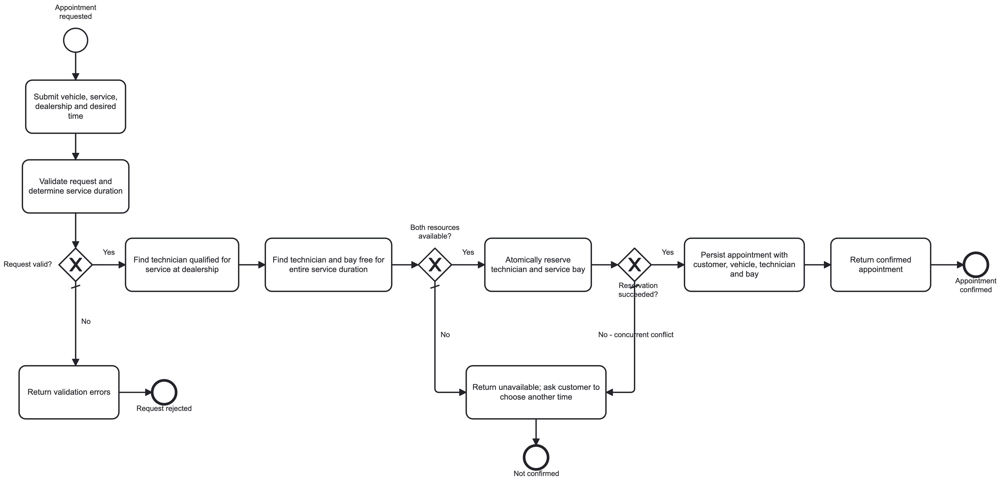

# Scenario A: Unified Service Scheduler — C4 Model

This model follows the challenge requirements: a customer requests a service appointment for a vehicle, service type, dealership, and desired time; the system checks for a qualified technician and service bay across the full service duration; a successful booking is stored as an appointment associating the customer, vehicle, technician, and bay.

## Level 1 — System Context

## Level 2 — Container Diagram

## Level 3 — Scheduler API Components

## Booking flow and key rules

1. The customer submits a vehicle, service type, dealership, and desired time through the web app.
2. The API validates the request and resolves the requested service duration.
3. The scheduler finds technicians qualified for that service at that dealership.
4. It checks candidate technicians and service bays for a continuous free interval covering the entire service duration. A partial overlap or availability of only one resource is insufficient.
5. If no pair of resources is available, the request is not confirmed and the customer receives an unavailable result (and may choose another time).
6. If both resources are available, the system creates one persistent appointment associating customer, vehicle, technician, and service bay.

## Assumptions captured in the model

- The booking user is modeled as the customer; the challenge does not specify separate staff-facing workflows.
- The scheduler owns its booking and resource data. No external dealer-management system or notification provider is required by the stated scenario.
- Appointment creation must be atomic with resource allocation so two concurrent requests cannot confirm overlapping use of the same technician or bay. The diagram leaves the database transaction/locking technique as an implementation decision.
- Authentication, payment, cancellation, rescheduling, and notification behavior are outside the stated acceptance criteria and are not modeled.
